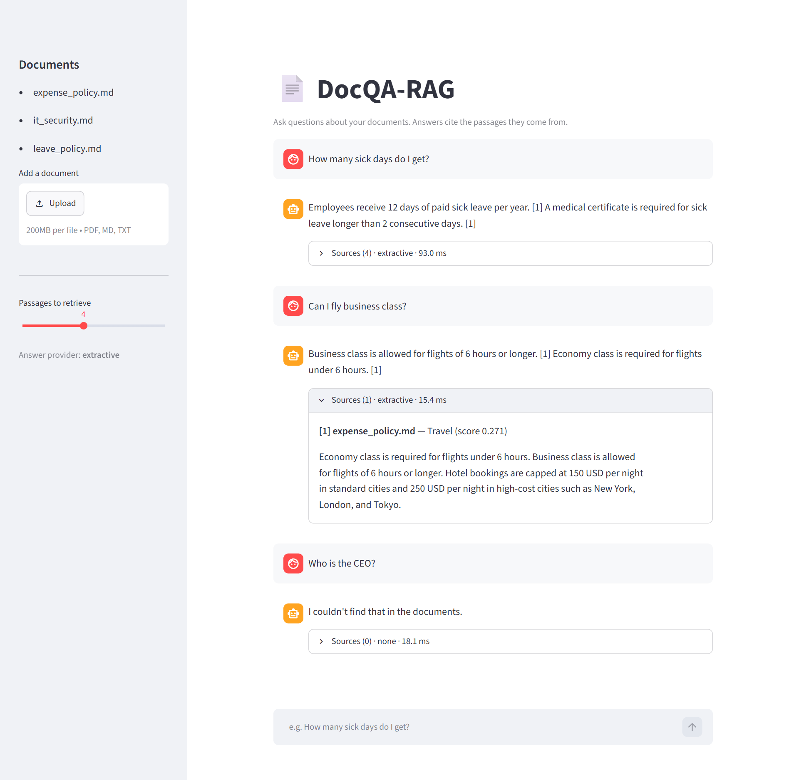

# DocQA-RAG — Ask Questions About Your Documents

[](https://github.com/k-Abhigna/DocQA-RAG/actions/workflows/ci.yml)


A retrieval-augmented generation (RAG) app: upload PDFs, Markdown, or text files,
ask questions in plain English, and get short answers that cite the passages they
came from. It runs fully offline by default and uses Claude or a local Ollama model
when one is available.



| Metric (18-question golden set, offline mode) | Score |
|---|---|
| Retrieval hit@4 | 100% |
| Mean reciprocal rank | 1.000 |
| Answer accuracy | 94% |

```
 documents ─► chunk (heading-aware, fence-safe) ─► TF-IDF index (word + char n-grams)
                                                          │
 question ──────────────────────────────► top-k retrieval (cosine, 0–1, higher = better)
                                                          │
                          answer generator: Claude │ Ollama │ extractive (no LLM)
                                                          │
                              cited answer + sources + latency  ─►  FastAPI / Streamlit
```

## Features
- **Ingestion**: `.pdf`, `.md`, `.txt`; heading-aware chunking with overlap; never splits inside code fences
- **Retrieval**: scikit-learn TF-IDF over word bigrams + character n-grams (handles typos), with a minimum-score cut-off so unrelated questions get "not found" instead of a made-up answer
- **Generation**: provider chosen automatically — Claude (`ANTHROPIC_API_KEY`), Ollama (local), or an extractive fallback that needs no model. If an LLM call fails, it falls back to the extractive answer.
- **Interfaces**: REST API (FastAPI, auto docs at `/docs`) and a chat UI (Streamlit) with expandable sources
- **Evaluation**: golden question set with hit@k, MRR, and answer accuracy, plus a pass/fail gate for CI
- **Tests and CI**: pytest suite covering chunking, retrieval, answers, and API validation; GitHub Actions runs the tests and the evaluation gate on Python 3.11–3.13 for every push

## Quick start (Windows PowerShell)
```powershell
cd "C:\Job\Resume\My Projects\AI Project\DocQA-RAG"
python -m venv .venv
.venv\Scripts\python -m pip install -r requirements.txt

# Chat UI  (demo link: http://localhost:8501/?q=How+many+sick+days+do+I+get%3F)
.venv\Scripts\streamlit run app.py

# REST API  ->  http://127.0.0.1:8000/docs
.venv\Scripts\uvicorn api:app --reload

# Tests and evaluation
.venv\Scripts\python -m pytest -q
.venv\Scripts\python -m evals.run_eval
```

## Choosing the answer model
| Setting | Effect |
|---|---|
| nothing set | extractive answers (offline, free) |
| `$env:ANTHROPIC_API_KEY = "sk-ant-..."` | Claude answers (`ANTHROPIC_MODEL`, default `claude-opus-5-5`) |
| install [Ollama](https://ollama.com), `ollama pull llama3.2` | local LLM answers (`OLLAMA_MODEL`) |
| `$env:LLM_PROVIDER = "extractive"` (or `anthropic` / `ollama`) | force a provider |

## API
```bash
curl -X POST http://127.0.0.1:8000/ask -H "Content-Type: application/json" \
     -d '{"question": "How many sick days do I get?", "k": 4}'
curl -F "file=@handbook.pdf" http://127.0.0.1:8000/documents
curl http://127.0.0.1:8000/health
```

## Project layout
```
rag/ingest.py     load + chunk documents
rag/index.py      TF-IDF retrieval index (save/load with joblib)
rag/llm.py        Claude / Ollama / extractive answer providers
rag/pipeline.py   end-to-end ask() pipeline
api.py            FastAPI service
app.py            Streamlit chat UI
evals/            golden set + evaluation gate
tests/            pytest suite
data/docs/        sample documents (fictional "Nimbus Labs" handbook)
```

## Possible next steps
- Replace TF-IDF with dense embeddings (e.g. `fastembed` / sentence-transformers) plus a vector DB (FAISS / Chroma), using hybrid retrieval with reciprocal-rank fusion
- Add a reranker, conversation memory, and streaming answers
- Containerise with Docker

Built with patterns from the `jeremylongshore/tons-of-skills-marketplace` skills:
`langchain-embeddings-search` (score direction, fence-safe chunking), `langchain-eval-harness`
(golden set and quality gate), `fastapi-ml-endpoint`, and `anthropic-pack`.
